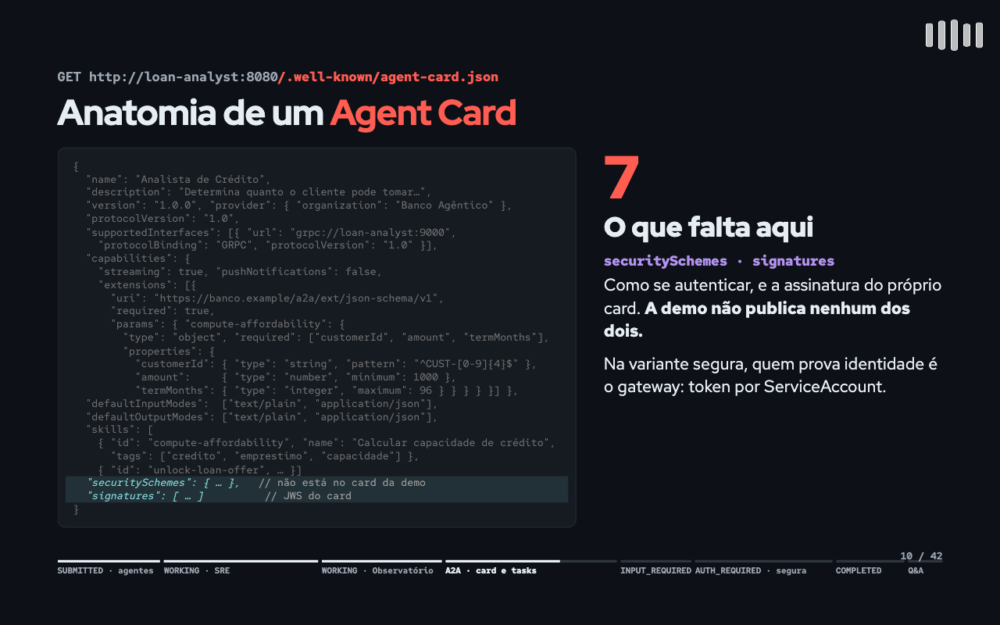

# Calíope na Tech Room “Agentes na Prática”

Como a Calíope (Workshop Co-presenter) opera a apresentação “Agentes na Prática” e as demos Agentic Bank e SRE Panel. Este documento cobre o que foi acrescentado ao co-presenter para essa apresentação em novembro de 2026 e como reaproveitar isso em outras apresentações.

O deck está em `~/repo/tech-room` (não é deste repositório). O banco está em `~/agentic-enterprise` (branch `rhcl-openshift-ai`), e o SRE Panel em `~/agentic-enterprise/scripts/sre/`.

**Deck versão 3 (19/11):** 53 slides (49 desde 26/11: saíram `agent card`, `tasks`, `governanca` e `levar`; o fim ficou `cliente`, `tres camadas`, `produto`, `obrigado`, `bonus`, `patinetes`, `fontes`, `perguntas` e o apêndice, com `sandbox` no apêndice; as instruções da Calíope presas a slides específicos saíram do prompt para o Jonathan refazer o roteiro dela), com o ato “Red Hat on the loop” no OpenShift. Para essa versão entraram a recusa ao “confirma para mim?” (4.4), o resultado das cenas da Mesa da demo no slide (4.5) e os nomes dos slides novos nas instruções.

## 1. Visão geral

```
microfone ─► painel da Calíope (Chrome, localhost:8787) ◄─WebRTC─► OpenAI Realtime (entende e decide, só texto)
                 │  │
                 │  └─ fala: POST /api/voz ─► say (voz pt-BR do macOS) ─► WAV ─► saída escolhida (BlackHole/fone)
                 │
                 └─ ferramentas: POST /api/tool ─► stage.mjs ─► Playwright ─► Chrome do palco (abas)
```

A Calíope tem três partes:

- **Ouvido e cérebro:** a sessão OpenAI Realtime transcreve a fala e decide. Ela devolve texto ou chamadas de ferramenta, nunca áudio direto (`create_response: false` e `interrupt_response: false`).
- **Voz:** o texto decidido vira áudio de dois jeitos. Por padrão, uma voz pt-BR do macOS gerada no servidor. Como alternativa, a voz da OpenAI, que tem sotaque americano.
- **Mãos:** `stage.mjs` controla um Chrome por Playwright. Esse Chrome é o “palco”, a janela que a plateia vê.

### 1.1 Disposição na apresentação

| Tela | Janela | Abas |
|---|---|---|
| Projetor ou tela visível | Chrome do palco (Playwright, `BROWSER_CHANNEL=chrome`) | 1 Apresentação · 2 Agentic Bank · 3 SRE Panel · (4 Observatório, sob demanda) |
| Notebook do apresentador | Chrome normal do Jonathan | Mesa da demo (`:9191`) · controle da Calíope (`:8787`) |

As abas do palco são criadas uma vez, quando alguém clica em **abrir palco**, nessa ordem. Depois disso, trocar de aba só traz a aba para a frente com `page.bringToFront()`. Nada é recarregado.

**Demo embutida (17/11):** o deck do tech-room tem o banco, o SRE Panel e o Observatório dentro dos slides (`window.deck.vivo`). Quando o deck tem isso, o palco fica com uma aba só e as ferramentas agem dentro do iframe: `mostrar_aba banco|sre|observatorio` vai para o slide do app, `mostrar_aba apresentacao` sai da demo para o próximo slide, os roteiros digitam no iframe com o mouse e o teclado da página do deck, e o empréstimo corre por trás (cliques pelo DOM, para não cair na janela da frente). Depois de digitar, o foco volta para o deck (`window.deck.sair`), para o passador continuar passando slide. `DEMO_URL`/`SRE_URL` e o botão da Mesa vão para o deck por `window.deck.alvos`; o deck não mistura local e OpenShift (um SRE local com banco no cluster é ignorado). Um deck sem `window.deck.vivo` continua com as três abas.

## 2. Como subir

**Pela Mesa da demo (jeito normal):** ao abrir “Mesa da demo.app”, a Mesa (`~/agentic-enterprise/scripts/painel/painel.py`, função `ensure_copiloto`) já sobe a Calíope pelo `~/repo/tech-room/apresentar.sh` se a 8787 não responder (log em `$TMPDIR/copiloto-voz.log`). Nos lados “Neste Mac” e “OpenShift” há um botão **Abrir copiloto de voz**: ele abre `http://127.0.0.1:8787/?demo=<Internet Banking>&sre=<SRE Panel>`, e o painel repassa essas URLs para `POST /api/alvo`. Com o palco já aberto, as abas do banco e do SRE Panel passam a apontar para a nova demo (o Observatório é fechado e reabre sob demanda). Variáveis da Mesa: `COPILOTO_PORT` (8787) e `COPILOTO_START` (caminho do script).

**Pelo terminal:**

```bash
cd ~/repo/tech-room
./apresentar.sh
```

O `apresentar.sh` exporta as variáveis e roda `npm start` aqui, sem tocar no `.env`:

| Variável | Valor padrão no script | Para quê |
|---|---|---|
| `DECK_URL` | `file://…/tech-room/index.html` | aba 1 |
| `DEMO_URL` | `http://localhost:8080/` | aba 2, Agentic Bank (o Observatório é `DEMO_URL/observatory`) |
| `SRE_URL` | `http://localhost:9292/` | aba 3, SRE Panel |
| `BROWSER_CHANNEL` | `chrome` | o palco usa o Google Chrome instalado |
| `PORT` | `8787` | painel da Calíope |
| `ASSISTANT_NAME` / `ASSISTANT_NICK` | `Calíope` / `Cali` | nome da co-apresentadora e apelido |
| `WAKE_WORDS` | `calíope, caliope, calliope, kalíope, kaliope, calíopi, caliopi, cali, kali, cáli` | palavras de ativação: o nome e as grafias que a transcrição costuma devolver. Vai para o campo **Ativação** do painel |
| `SPEECH_TERMS` | lista de termos | dica de vocabulário para a transcrição (Agent Card, sre-agent, MCP…) |

Para o banco num cluster, use `DEMO_URL=https://… SRE_URL=https://…/ ./apresentar.sh`.

No painel (`http://localhost:8787`): clique em **abrir palco**, depois em **conectar a voz**, e escolha o microfone, a saída e a voz.

### 2.1 Variáveis do co-presenter usadas aqui

| Variável | Padrão | Efeito |
|---|---|---|
| `CALIOPE_VOZ` | `Luciana` | voz pt-BR do macOS (`Luciana`, `Flo`, `Sandy`, `Shelley`, `Reed`, `Eddy`), ou `realtime` para a voz da OpenAI |
| `CALIOPE_RATE` | `195` | velocidade do `say`, em palavras por minuto |
| `VAD_THRESHOLD` | `0.6` | sensibilidade do detector de fala da OpenAI; suba para `0.75` em sala barulhenta |
| `SILENCE_MS` | `300` | pausa que fecha uma frase |
| `REALTIME_VOICE` | `marin` | voz da OpenAI, usada só com `CALIOPE_VOZ=realtime` |
| `TYPE_WPM` / `CURSOR_STEPS` | `40` / `16` | ritmo da digitação e do cursor nas demos |

## 3. Comandos por voz neste roteiro

O roteiro da palestra está no deck (README do tech-room). Os pedidos para a Calíope, em ordem:

| Momento | Fala do apresentador | Ferramenta | O que acontece |
|---|---|---|---|
| Slides | “próximo slide”, “volta”, “slide 5” | `proximo_slide`, `slide_anterior`, `ir_para_slide` | comando direto: não passa pelo modelo e não precisa do nome |
| Ir a um slide pelo assunto | “Calíope, vai para o slide de agentes autônomos” | `ir_para_slide {nome}` | procura pelo `data-nome` do slide; se não achar, pelo título |
| Demo | “vai para a demo” | `mostrar_aba {aba: banco}` | comando direto: traz a aba do Agentic Bank |
| Voltar aos slides | “volta para a apresentação” | `mostrar_aba {aba: apresentacao}` | comando direto |
| SRE | “vai para o SRE Panel” | `mostrar_aba {aba: sre}` | comando direto: só traz a aba. O sre-agent acorda no primeiro clique do apresentador no painel |
| Saldo, com o erro | “Calíope, inicia a demo” | `executar_roteiro iniciar_demo` | recarrega o banco como Ana, começa uma conversa nova e digita “Qual o meu saldo?” |
| Repetir | “Calíope, reinicia a demo” | `executar_roteiro reiniciar_demo` | o mesmo, com conversa nova |
| Observatório | “Calíope, abre o Observatório” | `executar_roteiro observatorio` | abre o Observatório numa aba própria, sem matar o chat |
| Empréstimo | “Calíope, continua” (no slide do Observatório) | `executar_roteiro pedir_emprestimo` | segundo plano, ver 4.2 |
| Situação | “Calíope, como está o empréstimo?” | `executar_roteiro situacao_emprestimo` | devolve a fase atual |
| O sim | “Calíope, confirma para mim?” | nenhuma | a recusa pronta, “Isso eu não posso. O sim é seu.”, sem passar pelo modelo; ver 4.4 |
| Cenas do cluster | nenhuma: são botões da Mesa da demo | | o resultado aparece num quadro por cima do slide; ver 4.5 |
| Explicação guiada | “Calíope, explica o próximo slide” / “explica esse slide” | `explicar_slide {proximo}` | ver seção 5 |
| Calar | “para”, “ok”, “chega”, “obrigado, Calíope”, Esc no painel | | ela para na hora e dorme |

O mapeamento de frases para ferramentas fica nas instruções do `agent.mjs`, na seção “Roteiro da apresentação”. Os comandos diretos são as expressões `DIRECT` em `public/copiloto.js`.

## 4. Roteiros do Agentic Bank (`stage.mjs`)

### 4.1 `iniciar_demo` / `reiniciar_demo`

`scriptStartBank(cliente='Ana', pergunta='Qual o meu saldo?')`:

1. `bankReady(cliente, {reload: true})`: recarrega `DEMO_URL`, espera o `#customerPicker`, troca de cliente se precisar (a troca recarrega com `?customer=`) e abre o chat flutuante (`#floatToggle`) se `#floatPanel` não tiver `panel-open`.
2. Clica em **+ nova conversa** (`#newChat`). Isso limpa o histórico e a pendência do `localStorage` do banco.
3. Digita a pergunta no `#q` como uma pessoa (cursor visível, cerca de 40 palavras por minuto) e clica em **Enviar**.

O roteiro devolve o controle assim que a pergunta é enviada. A resposta chega no chat e no Observatório.

**Regra (12/11):** toda pergunta nova ao banco começa uma conversa nova. `iniciar_demo`, `reiniciar_demo`, `perguntar_banco` e `pedir_emprestimo` clicam em **+ nova conversa** antes de perguntar (`newChat`). Só o “Quero contratar essa oferta.” do empréstimo continua na mesma conversa.

### 4.2 `pedir_emprestimo` (segundo plano)

O objetivo é que a Calíope peça o empréstimo pelo chat **enquanto a plateia olha o Observatório**:

1. Na aba do banco, sem trazê-la para a frente, preenche o `#q` com “Quero pedir um empréstimo de R$ 20.000 em 24 meses.” e aperta Enter (`fill` + `press`, que funcionam com a aba atrás).
2. A ferramenta responde na hora (`{ok, enviado, segue}`), e `loanFlow` continua sozinho:
   - espera uma nova bolha `#log .bubble.bot:not(.muted)`, com timeout de 240 s e polling de 1 s, sem depender de requestAnimationFrame, que não roda em aba de fundo;
   - se a resposta trouxer uma oferta (oferta, parcela, aprovada, liberada ou taxa) e não pedir confirmação, envia “Quero contratar essa oferta.”;
   - para quando a resposta pede confirmação (confirm…, autoriz…, “sim”, com “?”). Esse é o “clique humano”: **a Calíope nunca confirma**.
3. `situacao_emprestimo` lê `loanStatus.fase`. As fases são: pedido enviado, oferta recebida, pediu para contratar, esperando a confirmação humana (INPUT_REQUIRED), parou sem pedido de confirmação, ou falhou.

Parâmetros opcionais: `valor` (padrão 20000) e `prazo` (padrão 24).

O Playwright já sobe o Chromium com `--disable-background-timer-throttling` e `--disable-renderer-backgrounding`, então o `setTimeout` do chat do banco continua rodando com a aba atrás.

### 4.3 Abas (`mostrar_aba`)

- `open()`, o botão “abrir palco”, cria as abas Apresentação, Agentic Bank (`DEMO_URL`) e SRE Panel (`SRE_URL`, se definido), e traz a Apresentação para a frente.
- `showTab(aba)` aceita `apresentacao | banco | sre | observatorio`. Ela só chama `bringToFront()` e não navega.
- Os roteiros do banco usam a mesma aba 2. O Observatório usa uma aba 4 própria, para o chat do empréstimo seguir vivo na aba 2.

**SRE Panel:** em Chrome controlado pelo Playwright, toda aba informa `visibilityState: visible` e `hasFocus(): true`, mesmo estando atrás de outra. Por isso foco e visibilidade não servem para saber que a aba está na tela. A decisão foi que o sre-agent acorda no **primeiro clique ou tecla do apresentador na página**, e a Calíope não o acorda. A página ainda expõe `window.sreFoco(true)` (equivale ao clique), mas o palco não o chama.

### 4.4 O sim é do humano (19/11)

No slide `confirmacao`, o Jonathan pergunta “Calíope, confirma para mim?” e ela recusa: **“Isso eu não posso. O sim é seu.”** A frase está em `RECUSA` (`agent.mjs`; a variável `RECUSA` no ambiente troca o texto) e a regra é segurada em três lugares, do mais rápido ao mais duro:

1. **O painel responde na hora, sem o modelo** (`REFUSE`, `refuseCommand` e `refuse` em `public/copiloto.js`). Vale para um pedido de confirmar, aprovar, autorizar, clicar em Confirmar ou dizer “sim”, **com o nome dela na frase**: “Calíope, confirma para mim?”, “Calíope, aprova aí”, “Calíope, clica em Confirmar”, “Calíope, responde sim”. Funciona na voz da OpenAI, no ouvido rápido do Chrome, no plano B e na caixa de texto (na caixa, sem precisar do nome). Depois da recusa ela dorme, porque a frase seguinte do Jonathan é para a plateia. O mesmo pedido que chega duas vezes em 8 s (ouvido rápido e transcrição) é respondido uma vez só. “Calíope, confirma se o saldo está certo” e “vai para o slide da confirmação” não são pedidos de sim e seguem o caminho normal.
2. **O modelo tem a regra** nas instruções (`agent.mjs`, “O SIM É DO HUMANO”) e nas descrições de `clicar` e `preencher`. É o que vale quando o pedido vem sem o nome, com ela acordada.
3. **O palco recusa a ferramenta** (`humanOnly` em `stage.mjs`), mesmo que o modelo tente: `clicar` num alvo com confirmar, aprovar, autorizar, aceitar, contratar, efetivar ou “sim”; `preencher`, `perguntar_banco`, `iniciar_demo` e `reiniciar_demo` com um texto que o banco conta como o sim do cliente. A lista de textos é a mesma do banco (`AFFIRMATIVE` em `OpenAiCompatResource.java`): sim, confirmo, confirma, confirmar, confirmado, pode executar, pode prosseguir, pode contratar, quero contratar, aceito, autorizo, autorizado, prossiga, manda ver, ok pode, de acordo, yes, confirm. A ferramenta devolve `{ok: false, recusa: true, fala}` e o painel lê a `fala` no lugar de “não consegui”. `HUMAN_ONLY_CLICK` e `HUMAN_ONLY_TEXT` no ambiente trocam as listas (expressão regular sobre o texto sem acento).

O roteiro `pedir_emprestimo` não passa por essa guarda: ele mesmo envia “Quero contratar essa oferta.” e para no pedido de confirmação. **Cuidado no ensaio:** para o banco, essa frase também é um sim. Se sobrou uma contratação pendente da mesma cliente nos últimos 30 minutos, ela fica marcada como confirmada. Use “Resetar dados” na Mesa antes de começar e entre dois ensaios.

### 4.5 Cenas da Mesa da demo no palco (19/11)

As cenas do cluster (“Seguros tenta transferir”, “Apertar o orçamento do Crédito” e “Restaurar o orçamento do Crédito”) são botões da Mesa da demo, na linha “Red Hat on the loop”. A Calíope não as dispara: ela só leva o resultado para o palco.

- A Mesa roda `scripts/secured/cenas.py` e, a cada linha nova, manda `POST /api/stage/cena` com `{id, titulo, onde, estado, linhas}` (`estado`: `running`, `canceling`, `ok`, `failed` ou `canceled`; `fechar` tira o quadro).
- O servidor limita o que entra (corpo de até 64 KiB, 40 linhas de até 400 caracteres) e repassa para o deck: `stage.cena()` chama `window.deck.cena(c)`, que desenha um quadro por cima do slide atual. O deck escreve tudo como texto.
- A rota só aceita pedido desta máquina e sem `Origin` de outro site: quem chama é o servidor da Mesa, não uma página. As proteções da Mesa não mudaram, porque é ela que chama.
- Sem o palco aberto, ou num deck sem `window.deck.cena`, a resposta é `{ok: true, mostrado: false}` e o resultado fica só no console da Mesa.

## 5. Explicação guiada (`explicar_slide`)

Ela serve para a Calíope explicar um slide técnico passo a passo, sem improvisar. Foi usada no slide “Anatomia de um Agent Card”.

### 5.1 No deck

- Cada passo é um elemento `.frag`. O deck revela um por vez com →, aplica `data-at="N"` ao slide e `.cur` ao último passo revelado.
- `data-fala="…"` no `.frag` é o texto que a Calíope lê naquele passo. `data-fala-intro="…"` na `<section>` é lido antes do primeiro passo.
- O deck expõe `window.deck.guia(proximo)`. Ela vai ao próximo slide (ou fica no atual), zera os passos e devolve `{numero, intro, partes[]}`. Outras funções: `deck.goName(nome)` (devolve o número do slide ou 0), `deck.find`, `deck.lista()` e `deck.state()`.

### 5.2 Na Calíope

1. O modelo chama `explicar_slide {proximo: true}`. O `stage.mjs` chama `deck.guia` e devolve as partes.
2. No `response.done`, o painel vê o resultado de `explicar_slide` e chama `startGuided(out)`. Com voz nativa, ele já pede o áudio de todas as partes (`vozBlob`, com cache), para não haver pausa entre elas.
3. O painel lê a introdução. A cada `output_audio_buffer.stopped` (fim do áudio), `guidedNext()` faz `proximo_slide`, que acende o passo, e lê a fala seguinte. Na última, a Calíope fica acordada.
4. Durante a explicação, a Calíope **não para por som**: só para com palavra de parada (“para”, “ok”…) ou com o Esc. Isso evita que a voz dela voltando pela sala corte a explicação.
5. **Avanço só pelo fim real do áudio (15/11).** Cada trecho termina no `output_audio_buffer.stopped`: o `ended` do áudio nativo ou o fim do áudio da OpenAI. Só então o passo acende e o próximo trecho começa, sem espera. Não há avanço por tempo nem timer (27/11: saíram o respiro de 450 ms e os 1,5 s do passo sem fala). Um passo sem fala acende junto com o seguinte. Se a voz falha num trecho, a explicação para inteira em vez de pular o trecho. Cada trecho avança uma vez só (`guided.falando`), então um fim duplicado não pula trecho. Enquanto ela explica, nenhuma outra fala entra por cima (`sayAloud` sem `guia` é ignorado e registrado); só “para” e Esc param a sequência inteira.
6. **Causa do corte de 15/11:** com a voz da OpenAI, a sessão tinha teto de 800 tokens por resposta (`max_output_tokens`, cerca de 30 s). O trecho da extensão do Agent Card tem 108 palavras, mais de 40 s: a OpenAI cortava o áudio no teto, o fim do áudio chegava e a explicação passava para o próximo trecho. Agora cada leitura (`etapa: 'falar'`) vai com `max_output_tokens: 'inf'`, e uma resposta `incomplete` aparece como erro no registro.

Para usar em outro deck, basta pôr `data-fala` nos `.frag` e implementar `window.deck.guia`. O resto é genérico.

## 6. Voz

### 6.1 Voz nativa pt-BR (padrão)

- `GET /api/config` devolve `voz` e `vozes` (`realtime` mais as vozes pt_BR do `say -v '?'`, sem Grandma, Grandpa e Rocko).
- `POST /api/voz {texto, voz?}` gera WAV LEI16 a 24 kHz com `say -v <voz> -r CALIOPE_RATE` e devolve `audio/wav`. Leva cerca de 1 s por frase.
- `POST /api/voz/escolher {voz}` troca a voz em tempo de execução. É o seletor **Voz** do painel, com o botão **ouvir** para testar.
- No painel, `sayAloud(texto)` chama `sayNative`: toca o WAV em `Audio` com `setSinkId` na saída escolhida (BlackHole para o Meet), com uma cópia no dispositivo padrão se **ouvir no fone também** estiver marcado. O painel emite `output_audio_buffer.started` e `.stopped` para os mesmos estados da voz da OpenAI.
- Para mais qualidade: em Ajustes do Sistema › Acessibilidade › Conteúdo Falado › Gerenciar Vozes, baixe a Luciana (Premium/Melhorada). Ela passa a aparecer no seletor.

### 6.2 Voz da OpenAI (`CALIOPE_VOZ=realtime`)

O caminho antigo: `response.create` com `output_modalities: ['audio']`, `conversation: 'none'` e as instruções de “ler exatamente o texto” mais `VOICE_STYLE`. É mais natural, mas tem sotaque americano mesmo com as instruções de sotaque.

### 6.3 Próximo passo possível

Uma voz neural pt-BR (Google Cloud TTS ou Azure, como Francisca ou Antonio) entra no mesmo lugar: basta outro `sintetizar()` no `server.mjs`. Isso exige uma chave do provedor.

### 6.4 Espectro de voz no palco

Enquanto a Calíope fala, cinco barras brancas translúcidas, compridas e arredondadas, sobem e descem no **canto superior direito** das abas do palco e do painel. Se o selo “Calíope ouvindo” estiver na tela, elas ficam logo abaixo dele. Não há texto nem brilho, e elas entram e saem com fade. Nos 42 slides do tech-room, em 1440×900 e 1920×1080, só a órbita decorativa da capa passa sob elas; nenhum texto fica coberto.



**Como funciona:**

- Quando ela começa a falar (`output_audio_buffer.started`, com qualquer voz), o painel chama `POST /api/stage/espectro {acao:'sintetico'}`. Quando ela para (`stopped`/`cleared`, “para”, Esc), chama `{acao:'parar'}`. O `stage.mjs` injeta `public/espectro.js` em cada aba aberta do palco, e cada aba anima sozinha a cerca de 30 fps, com `transform: scaleY` em 5 elementos, sem canvas.
- **Animação sintética, de propósito:** ruído suave com ritmo de sílabas (4 a 5 Hz), com as barras do meio subindo mais. O painel não toca, não decodifica e não analisa o áudio. Medir o áudio real da voz da OpenAI exigiria um `AudioContext` no painel, e depois da voz “robótica” de 15/11 não vale o risco no ar. São só duas mensagens por fala, sem tráfego contínuo.
- **Posição:** 22 px da direita, 16 px do topo, ou 10 px abaixo do selo (`#__caliope_badge`). Usam `pointer-events: none`.
- **Visual sem reiniciar:** o `stage.mjs` relê `public/espectro.js` a cada fala e, se o arquivo mudou, troca a versão já injetada na aba (`destroy`). Mudar o visual vale na próxima fala; no painel, basta F5.
- **Movimento reduzido:** com `prefers-reduced-motion: reduce`, as barras só ondulam devagar, com fade e sem escala.
- **Isolado:** `espectro()` no painel fica dentro de try/catch e não mexe em `speaking`, nos eventos de fala, no microfone nem no filtro de eco.

**Ligar, desligar e conferir:** caixa **espectro no palco** no painel, ao lado de **selo no palco**. O botão **testar barras**, ao lado, acende as barras por 3 s no palco e no painel, sem ela falar. As barras também aparecem no próprio painel, só como 5 elementos em CSS, sem nada de áudio.

**Precisa do servidor reiniciado uma vez:** a rota `/api/stage/espectro` e a injeção no palco são do servidor. Com um servidor anterior a 15/11, o painel novo recebe 405 nessa rota e as barras não aparecem, sem nenhum efeito na voz. Painel e palco são navegadores diferentes (o deck é `file://`), então não há BroadcastChannel nem postMessage entre eles.

**Histórico de 15/11:** a primeira versão era uma pílula com orbe, nome e 31 barras, e usava as bandas reais do WAV, analisadas no painel (7dc3ca7). Depois dela, o Jonathan ouviu a voz robótica, e a análise saiu (e8cbe9d). Ele achou o visual exagerado e pediu barras simples e translúcidas (1611a58), embaixo. Depois pediu as barras no canto superior direito, mais compridas, brancas e translúcidas: esta é a versão atual.

**Arquivos:** `public/espectro.js`, `stage.mjs` (`espectro()`), `server.mjs` (`POST /api/stage/espectro`), `public/copiloto.js` (`espectro()` e ganchos) e `public/index.html` (caixa).

**Teste (simulação, sem microfone):** servidor numa porta separada com `HEADLESS=1` e o deck do tech-room. Com uma fala da Luciana, as barras aparecem com o áudio e somem ao fim. O Esc apaga as barras, também no meio da fala. Desligado, elas não aparecem. Com movimento reduzido, aparece a versão calma. O `npm test` passa.

## 7. Barulho, eco e cortes

Problema visto no ensaio de 10/11: a Calíope “engasgava” na explicação do Agent Card. O detector de fala da OpenAI cortava a resposta a cada som, inclusive a voz dela voltando pela sala.

O que mudou:

| Onde | Mudança |
|---|---|
| `server.mjs` | `interrupt_response: false`: o servidor nunca corta a fala; quem decide é o painel |
| `server.mjs` | `threshold: VAD_THRESHOLD` (padrão 0,6) no `server_vad` |
| `copiloto.js` | barge-in só depois de `BARGE_MS` (500 ms) de som contínuo; tosse, porta e eco curto não cortam |
| `copiloto.js` | na explicação guiada, nenhum som corta; só palavra de parada ou Esc |
| `copiloto.js` | toda fala que **começa** enquanto ela fala (`duringCaliope`, por `item_id`) é tratada como eco: a transcrição é ignorada, a não ser que seja palavra de parada. Assim ela não responde a si mesma |
| `copiloto.js` (15/11) | **com ela calada, a sua fala nunca é eco.** A comparação de texto com o que ela disse (`soundsLikeMe`) só vale enquanto ela fala ou até 4 s depois (`ECHO_TEXT_MS`, por causa da transcrição atrasada); antes valia por 90 s. E “pensando” (`responding`, sem som saindo) não marca mais eco. Os dois descartavam quase tudo o que o Jonathan dizia depois de uma explicação longa |

Mesmo assim: use fone ou microfone de lapela, e o microfone real como entrada. O “ouvido rápido” do Chrome usa o microfone padrão do sistema.

## 8. Testes

- `npm test` (`test/e2e.mjs`) roda com `CALIOPE_VOZ=realtime`, porque verifica o caminho de leitura da OpenAI. Cobre os comandos diretos, as palavras de parada, o barge-in de 500 ms, as ações em silêncio e o Banco Demo de teste.
- Desde 27/11 o `npm test` roda também `test/guia.mjs`, com o deck de teste `public/deck/guia.html` (8 passos, 3 sem fala): explicação longa inteira, trechos completos e em ordem só no fim real do áudio, sem atraso por timer, eco e fala nova sem cortar, “Caliope, para”, “Calíope, para” e Esc parando a fila inteira, e voz que falha parando a explicação em vez de pular o trecho.
- Desde 19/11 o `npm test` cobre também a recusa (as frases que pedem o sim e as que não pedem; a fala única sem o modelo; ela dorme depois; a ferramenta recusada vira a mesma fala; a caixa de texto), a guarda do palco (`clicar` em Confirmar, `preencher` e `perguntar_banco` com “sim”) e a rota `/api/stage/cena` (aceita a Mesa, recusa outra origem e corpo grande).
- Teste da cadeia inteira em 19/11, por simulação e sem cluster: um `oc` de mentira, a Mesa de verdade, este servidor de verdade e o deck versão 3 de verdade. Os três botões da Mesa viraram o quadro certo no slide 24, e os 53 nomes de slide das instruções levam cada um ao seu slide. **Não testado:** a recusa com voz e microfone reais, e as cenas num cluster vivo.
- Testes manuais desta apresentação, feitos headless com `HEADLESS=1` e servidor em outra porta:
  - `ir_para_slide {nome}` para autonomos, agent card, a2a e humano no circuito;
  - `mostrar_aba` banco, sre e apresentacao;
  - `iniciar_demo`, `observatorio` e `pedir_emprestimo` contra o banco local com LLM mock (o mock não gera oferta, então a fase final foi “parou sem pedido de confirmação”);
  - explicação guiada com eventos simulados: eco ignorado e “Para.” corta;
  - explicação guiada com a voz Luciana: intro e primeira parte lidas, avanço automático.

## 9. Arquivos tocados

| Arquivo | O que mudou |
|---|---|
| `agent.mjs` | ferramentas `mostrar_aba` e `explicar_slide`; `ir_para_slide` com `nome`; roteiros novos em `executar_roteiro`; seção “Roteiro da apresentação” nas instruções |
| `stage.mjs` | `retarget`/`alvos`; abas fixas (`open`, `showTab`, `srePage`, `obsPage`); `bankReady`, `scriptStartBank`, `scriptLoan` e `loanFlow`; `explicar_slide` |
| `server.mjs` | `SRE_URL`; `GET/POST /api/alvo` (URLs da demo em tempo de execução); `interrupt_response: false` e `threshold`; `/api/voz`, `/api/voz/escolher`, voz em `/api/config` |
| `public/copiloto.js` | explicação guiada; voz nativa (`sayNative`, `vozBlob`); barge-in com atraso; filtro de eco; comandos diretos de aba; seletor de voz |
| `public/index.html` | linha **Voz** com o botão **ouvir** |
| `test/e2e.mjs` | `CALIOPE_VOZ=realtime`; barge-in espera 650 ms |
| `public/espectro.js` (novo) | barras de voz sobre o palco, só enquanto ela fala (6.4) |
| `agent.mjs` (19/11) | `RECUSA`; a regra “o sim é do humano”; o roteiro e os 53 nomes de slide do deck versão 3 |
| `stage.mjs` (19/11) | `humanOnly` e a recusa em `clicar`, `preencher` e nos roteiros que digitam no banco; `cena()` |
| `server.mjs` (19/11) | `recusa` em `/api/config`; `fala` na ferramenta recusada; `POST /api/stage/cena`, com limite de tamanho e de origem |
| `public/copiloto.js` (19/11) | `REFUSE`, `refuseCommand`, `refuse` e `noteRefusal`; `sayAloud` com `dorme` |
| `test/e2e.mjs` (19/11) | a recusa, a guarda do palco e a rota das cenas |

## 10. Limites conhecidos

- A explicação guiada só funciona em deck que tenha `window.deck.guia`. Num deck sem isso, a ferramenta devolve um erro amigável.
- Os critérios de oferta e de confirmação do `loanFlow` são expressões sobre o texto da resposta do banco. Se o prompt do assistente mudar o jeito de perguntar, ajuste `asksConfirm`.
- Com `SHELL_CHAT_URL` preenchido no cluster, o chat do banco vira Open WebUI em iframe, e os roteiros do banco (`#q`, `#log`) não funcionam.
- O `say` só existe no macOS. Em outro sistema, `/api/config` não lista vozes e é preciso usar `CALIOPE_VOZ=realtime`.
- A recusa pronta precisa do nome dela na frase. Sem o nome e com ela acordada, quem responde é o modelo, com a mesma regra; o palco recusa a ferramenta de qualquer jeito.
- A lista do que conta como sim (`HUMAN_ONLY_TEXT`) copia a do banco. Se o banco mudar a `AFFIRMATIVE`, mude aqui também.
- O servidor escuta em todas as interfaces de rede, e as rotas antigas (`/api/tool`, `/api/alvo`, `/api/voz`) não conferem de onde vem o pedido. Só `/api/stage/cena` confere. Numa rede compartilhada, quem alcançar a porta 8787 consegue mandar comandos para o palco.
