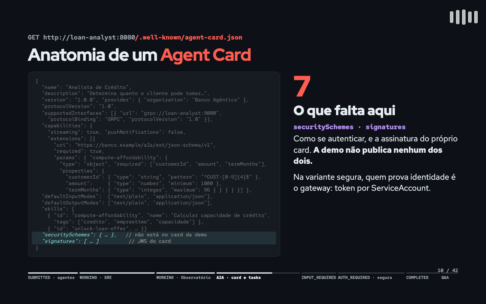

# Calíope in the "Agentes na Prática" Tech Room

How Calíope runs the talk "Agentes na Prática" (a pt-BR talk) and the Agentic Bank and SRE Panel demos, and how to
reuse that in other talks.

The deck lives in `~/repo/tech-room` (not in this repo). The bank lives in `~/agentic-enterprise` (branch
`rhcl-openshift-ai`), and the SRE Panel in `~/agentic-enterprise/scripts/sre/`.

## 1. Overview

```
mic ─► Calíope panel (Chrome, localhost:8787) ◄─WebRTC─► OpenAI Realtime (understands and decides, text only)
            │  │
            │  └─ speech: POST /api/voice ─► say (macOS voice for LANGUAGE) ─► WAV ─► chosen output (BlackHole/headphones)
            │
            └─ tools: POST /api/tool ─► stage.mjs ─► Playwright ─► stage Chrome (tabs)
```

Calíope has three parts:

- **Ears and brain:** the OpenAI Realtime session transcribes and decides. It returns text or tool calls, never audio
  directly (`create_response: false` and `interrupt_response: false`).
- **Voice:** the decided text becomes audio in one of two ways. By default, a macOS voice for the talk language,
  generated on the server. Alternatively, the OpenAI voice, which keeps an American accent in other languages.
- **Hands:** `stage.mjs` drives a Chrome through Playwright. That Chrome is the "stage", the window the audience sees.

### 1.1 Layout during the talk

| Screen | Window | Tabs |
|---|---|---|
| Projector or shared screen | Stage Chrome (Playwright, `BROWSER_CHANNEL=chrome`) | 1 Presentation · 2 Agentic Bank · 3 SRE Panel · (4 Observatory, on demand) |
| Presenter's laptop | Jonathan's normal Chrome | Demo console "Mesa da demo" (`:9191`) · Calíope panel (`:8787`) |

The stage tabs are created once, when **Open stage window** is clicked, in that order. After that, switching tabs only
brings a tab to the front with `page.bringToFront()`. Nothing reloads.

**Embedded demo:** the tech-room deck hosts the bank, the SRE Panel and the Observatory inside the slides
(`window.deck.vivo`). With such a deck the stage has one tab and the tools act inside the iframe: `show_tab
bank|sre|observatory` goes to the app's slide, `show_tab presentation` leaves the demo to the next slide, scripts type in
the iframe with the deck page's mouse and keyboard, and the loan runs behind (DOM clicks, so they never land on the front
window). After typing, focus goes back to the deck (`window.deck.sair`) so the clicker keeps changing slides.
`DEMO_URL`/`SRE_URL` and the console button reach the deck through `window.deck.alvos`; the deck never mixes local and
OpenShift (a local SRE with a cluster bank is ignored). A deck without `window.deck.vivo` keeps the three tabs.

### 1.2 Deck contract

The deck's API is the deck's own and keeps its Portuguese names; the co-presenter adapts to it:

| Deck API | Used for |
|---|---|
| `window.deck.state()` → `{numero, total, titulo, notas}` (or `number`, `title`, `notes`) | current slide sent to the model |
| `window.deck.go(i)`, `window.deck.goName(nome)` | `go_to_slide` by number or name |
| `window.deck.guia(next)` → `{intro, partes}` (or `parts`) | `explain_slide` |
| `window.deck.vivo(app, show)` with `app` = `banco`, `sre`, `observatorio`; `.livewin[data-app=…] iframe` | embedded demo |
| `window.deck.voltar()`, `window.deck.sair()`, `window.deck.alvos({demo, sre})`, `window.deck.cena(c)` | back to slides, release keys, demo URLs, scenes |

## 2. Starting it

**From the demo console (the normal way):** opening "Mesa da demo.app", the console
(`~/agentic-enterprise/scripts/painel/painel.py`, function `ensure_copiloto`) starts Calíope with
`~/repo/tech-room/apresentar.sh` if port 8787 does not answer (log in `$TMPDIR/copiloto-voz.log`). The "Neste Mac" and
"OpenShift" sides have an **Abrir copiloto de voz** button: it opens
`http://127.0.0.1:8787/?demo=<Internet Banking>&sre=<SRE Panel>`, and the panel forwards those URLs to
`POST /api/target`. With the stage already open, the bank and SRE Panel tabs point to the new demo (the Observatory is
closed and reopens on demand). Console variables: `COPILOTO_PORT` (8787) and `COPILOTO_START` (script path).

**From the terminal:**

```bash
cd ~/repo/tech-room
./apresentar.sh
```

`apresentar.sh` exports the variables and runs `npm start` here, without touching `.env`:

| Variable | Default in the script | Purpose |
|---|---|---|
| `DECK_URL` | `file://…/tech-room/index.html` | tab 1 |
| `DEMO_URL` | `http://localhost:8080/` | tab 2, Agentic Bank (the Observatory is `DEMO_URL/observatory`) |
| `SRE_URL` | `http://localhost:9292/` | tab 3, SRE Panel |
| `BROWSER_CHANNEL` | `chrome` | the stage uses the installed Google Chrome |
| `PORT` | `8787` | Calíope panel |
| `ASSISTANT_NAME` / `ASSISTANT_NICK` | `Calíope` / `Cali` | co-presenter name and nickname |
| `WAKE_WORDS` | `calíope, caliope, calliope, kalíope, kaliope, calíopi, caliopi, cali, kali, cáli` | wake words: the name and the spellings the transcript tends to return. Accents do not matter. Goes to the panel's **Wake words** field |
| `SPEECH_TERMS` | list of terms | vocabulary hint for the transcription (Agent Card, sre-agent, MCP…) |

For the bank on a cluster, use `DEMO_URL=https://… SRE_URL=https://…/ ./apresentar.sh`.

In the panel (`http://localhost:8787`): click **Open stage window**, then **Connect voice**, and pick the mic, the
output and the voice.

### 2.1 Co-presenter variables used here

| Variable | Default | Effect |
|---|---|---|
| `LANGUAGE` | `pt-BR` | talk language: her speech, transcription, Chrome recognition, macOS voices, fixed phrases |
| `CALIOPE_VOICE` | `Luciana` (pt-BR) | macOS voice (`Luciana`, `Flo`, `Sandy`, `Shelley`, `Reed`, `Eddy` for pt-BR), or `realtime` for the OpenAI voice. `CALIOPE_VOZ` still works |
| `CALIOPE_RATE` | `195` | `say` speed, words per minute |
| `VAD_THRESHOLD` | `0.6` | OpenAI speech detector sensitivity; raise to `0.75` in a noisy room |
| `SILENCE_MS` | `300` | pause that closes a sentence |
| `REALTIME_VOICE` | `marin` | OpenAI voice, used only with `CALIOPE_VOICE=realtime` |
| `TYPE_WPM` / `CURSOR_STEPS` | `40` / `16` | typing and cursor pace in demos |
| `BANK_BALANCE_QUESTION`, `BANK_LOAN_REQUEST`, `BANK_ACCEPT_OFFER` | pt-BR sentences | what the scripts type into the bank chat |

## 3. Voice commands in this talk

The talk script lives in the deck (tech-room README). Requests to Calíope, in order (the talk is in Portuguese, so the
examples are too; the English equivalents work as well):

| Moment | Presenter says | Tool | What happens |
|---|---|---|---|
| Slides | "próximo slide", "volta", "slide 5" | `next_slide`, `previous_slide`, `go_to_slide` | direct command: no model, no name needed |
| Slide by topic | "Calíope, vai para o slide de agentes autônomos" | `go_to_slide {name}` | looks for the slide's `data-nome`; otherwise the title |
| Demo | "vai para a demo" | `show_tab {tab: bank}` | direct command: brings the Agentic Bank tab |
| Back to slides | "volta para a apresentação" | `show_tab {tab: presentation}` | direct command |
| SRE | "vai para o SRE Panel" | `show_tab {tab: sre}` | direct command: only brings the tab. The sre-agent wakes on the presenter's first click on the panel |
| Balance, with the error | "Calíope, inicia a demo" | `run_script start_demo` | reloads the bank as Ana, starts a new chat and types the balance question |
| Repeat | "Calíope, reinicia a demo" | `run_script restart_demo` | same, with a new chat |
| Observatory | "Calíope, abre o Observatório" | `run_script observatory` | opens the Observatory in its own tab, keeping the chat alive |
| Loan | "Calíope, continua" (on the Observatory slide) | `run_script request_loan` | background, see 4.2 |
| Status | "Calíope, como está o empréstimo?" | `run_script loan_status` | returns the current phase |
| The yes | "Calíope, confirma para mim?" | none | the ready refusal, "Isso eu não posso. O sim é seu.", without the model; see 4.4 |
| Cluster scenes | none: they are console buttons | | the result shows in a card over the slide; see 4.5 |
| Guided explanation | "Calíope, explica o próximo slide" / "explica esse slide" | `explain_slide {next}` | see section 5 |
| Silence | "para", "ok", "chega", "stop", "obrigado, Calíope", Esc in the panel | | she stops at once and sleeps |

The mapping from sentences to tools lives in the `agent.mjs` instructions, section "Script of the talk". Direct commands
are the `DIRECT` expressions in `public/copilot.js`.

## 4. Agentic Bank scripts (`stage.mjs`)

### 4.1 `start_demo` / `restart_demo`

`scriptStartBank(customer='Ana', question=BANK.balance)`:

1. `bankReady(customer, {reload: true})`: reloads `DEMO_URL`, waits for `#customerPicker`, switches customer if needed
   (switching reloads with `?customer=`) and opens the floating chat (`#floatToggle`) if `#floatPanel` lacks `panel-open`.
2. Clicks **+ nova conversa** (`#newChat`). That clears the history and the pending state in the bank's `localStorage`.
3. Types the question in `#q` like a person (visible cursor, about 40 words per minute) and clicks **Enviar**.

The script returns as soon as the question is sent. The answer arrives in the chat and in the Observatory.

**Rule:** every new question to the bank starts a new chat. `start_demo`, `restart_demo`, `ask_bank` and `request_loan`
click **+ nova conversa** before asking (`newChat`). Only the loan's "Quero contratar essa oferta." stays in the same chat.

### 4.2 `request_loan` (background)

The goal is for Calíope to request the loan in the chat **while the audience watches the Observatory**:

1. In the bank tab, without bringing it to the front, fills `#q` with "Quero pedir um empréstimo de R$ 20.000 em 24 meses."
   and presses Enter (`fill` + `press`, which work with the tab behind).
2. The tool answers at once (`{ok, sent, continues}`), and `loanFlow` goes on by itself:
   - waits for a new bubble `#log .bubble.bot:not(.muted)`, with a 240 s timeout and 1 s polling, not relying on
     requestAnimationFrame, which does not run in a background tab;
   - if the reply has an offer (oferta, parcela, aprovada, liberada or taxa, or the English words) and asks no
     confirmation, sends "Quero contratar essa oferta.";
   - stops when the reply asks for confirmation (confirm…, autoriz…, "sim", with "?"). That is the "human click":
     **Calíope never confirms**.
3. `loan_status` reads `loanStatus.phase`: request sent, offer received, asked to take the offer, waiting for human
   confirmation (INPUT_REQUIRED), stopped without a confirmation request, or failed.

Optional parameters: `amount` (default 20000) and `term` (default 24).

Playwright already starts Chromium with `--disable-background-timer-throttling` and `--disable-renderer-backgrounding`,
so the bank chat's `setTimeout` keeps running with the tab behind.

### 4.3 Tabs (`show_tab`)

- `open()`, the **Open stage window** button, creates the Presentation, Agentic Bank (`DEMO_URL`) and SRE Panel
  (`SRE_URL`, if set) tabs, and brings the Presentation to the front.
- `showTab(tab)` takes `presentation | bank | sre | observatory` (the Portuguese names also work). It only calls
  `bringToFront()` and never navigates.
- The bank scripts use the same tab 2. The Observatory uses its own tab 4, so the loan chat stays alive in tab 2.

**SRE Panel:** in a Playwright-driven Chrome every tab reports `visibilityState: visible` and `hasFocus(): true`, even
behind another one. So focus and visibility cannot tell that the tab is on screen. The sre-agent wakes on the
**presenter's first click or key on the page**, and Calíope never wakes it. The page still exposes `window.sreFoco(true)`
(same as the click), but the stage never calls it.

### 4.4 The yes belongs to the human

On the `confirmacao` slide, the presenter asks "Calíope, confirma para mim?" and she refuses: **"Isso eu não posso. O sim
é seu."** The sentence is `PHRASES.refusal` in `agent.mjs`, per language (`REFUSAL` in the environment replaces it), and
the rule is enforced in three places, fastest to hardest:

1. **The panel answers at once, without the model** (`REFUSE`, `refuseCommand` and `refuse` in `public/copilot.js`). It
   covers a request to confirm, approve, authorize, click Confirm or say "yes", in Portuguese or English, **with her name
   in the sentence**: "Calíope, confirma para mim?", "Calíope, aprova aí", "Calíope, confirm it for me", "Calíope, say
   yes". It works with the OpenAI voice, Chrome's fast ear, plan B and the text box (in the box, no name needed). After
   the refusal she sleeps, because the presenter's next sentence is for the audience. The same request arriving twice
   within 8 s (fast ear and transcript) is answered once. "Calíope, confirma se o saldo está certo", "confirm whether
   the balance is right" and "vai para o slide da confirmação" are not requests for a yes and take the normal path.
2. **The model has the rule** in its instructions (`agent.mjs`, "THE YES BELONGS TO THE HUMAN") and in the `click` and
   `fill` descriptions. That is what applies when the request comes without her name, while she is awake.
3. **The stage refuses the tool** (`humanOnly` in `stage.mjs`), even if the model tries: `click` on a target with
   confirm, approve, authorize, accept, contract, carry out or "yes" (pt and en); `fill`, `ask_bank`, `start_demo` and
   `restart_demo` with a text the bank counts as the customer's yes. The text list is the bank's (`AFFIRMATIVE` in
   `OpenAiCompatResource.java`) plus English. The tool returns `{ok: false, refused: true, say}` and the panel reads
   `say` instead of "I couldn't". `HUMAN_ONLY_CLICK` and `HUMAN_ONLY_TEXT` in the environment replace the lists (regular
   expressions on accent-free text).

The `request_loan` script does not go through this guard: it sends "Quero contratar essa oferta." itself and stops at the
confirmation request. **Careful in rehearsals:** for the bank that sentence is also a yes. If a pending contract from the
same customer is left from the last 30 minutes, it gets marked as confirmed. Use "Resetar dados" on the console before
starting and between rehearsals.

### 4.5 Demo console scenes on stage

The cluster scenes ("Seguros tenta transferir", "Apertar o orçamento do Crédito" and "Restaurar o orçamento do Crédito")
are console buttons, in the "Red Hat on the loop" row. Calíope never triggers them: she only brings the result to the stage.

- The console runs `scripts/secured/cenas.py` and, on each new line, sends `POST /api/stage/cena` with
  `{id, titulo, onde, estado, linhas}` (`estado`: `running`, `canceling`, `ok`, `failed` or `canceled`; `fechar` removes
  the card). These field names are the console's and the deck's contract.
- The server limits what comes in (body up to 64 KiB, 40 lines of up to 400 characters) and passes it to the deck:
  `stage.scene()` calls `window.deck.cena(c)`, which draws a card over the current slide. The deck writes it all as text.
- The route only accepts requests from this machine and without an `Origin` from another site: the caller is the
  console server, not a page.
- Without the stage open, or with a deck without `window.deck.cena`, the answer is `{ok: true, shown: false}` and the
  result stays in the console.

## 5. Guided explanation (`explain_slide`)

It lets Calíope explain a technical slide step by step, without improvising. It was used on the "Anatomia de um Agent
Card" slide.

### 5.1 In the deck

- Each step is a `.frag` element. The deck reveals one at a time with →, sets `data-at="N"` on the slide and `.cur` on
  the last revealed step.
- In the tech-room deck, `data-fala="…"` on the `.frag` is the line Calíope reads for that step, and `data-fala-intro="…"`
  on the `<section>` is read before the first step.
- The deck exposes `window.deck.guia(next)`. It goes to the next slide (or stays), resets the steps and returns
  `{numero, intro, partes[]}`.

### 5.2 In Calíope

1. The model calls `explain_slide {next: true}`. `stage.mjs` calls `deck.guia` and returns the parts.
2. On `response.done`, the panel sees the `explain_slide` result and calls `startGuided(out)`. With a native voice it
   requests the audio of every part up front (`voiceBlob`, cached), so there is no gap between them.
3. The panel reads the intro. On each `output_audio_buffer.stopped` (end of audio), `guidedNext()` runs `next_slide`,
   which lights the step, and reads the next line.
4. During the explanation Calíope **does not stop for sound**: only for a stop word ("para", "stop", "ok"…) or Esc.
   That keeps her own voice coming back from the room from cutting the explanation.
5. **Advance only at the real end of the audio.** Each part ends on `output_audio_buffer.stopped`: the native audio's
   `ended` or the end of the OpenAI audio. Only then does the step light up and the next part start, with no wait. There
   is no advance by time and no timer. A step without a line lights up together with the next one. If the voice fails on
   a part, the whole explanation stops instead of skipping the part. Each part advances once (`guided.speaking`), so a
   duplicate end never skips a part. While she explains, no other speech gets in (`sayAloud` without `guide` is ignored
   and logged); only "stop"/"para" and Esc stop the whole sequence.
6. Each reading (`stage: 'speak'`) goes with `max_output_tokens: 'inf'`, because the session cap (800 tokens, about
   30 s) used to cut long parts; an `incomplete` response shows as an error in the log.

To use it in another deck, put the lines on the `.frag`s and implement `window.deck.guia`. The rest is generic.

## 6. Voice

### 6.1 Native macOS voice (default)

- `GET /api/config` returns `voice` and `voices` (`realtime` plus the `say -v '?'` voices for `LANGUAGE`, without
  Grandma, Grandpa and Rocko).
- `POST /api/voice {text, voice?}` makes a 24 kHz LEI16 WAV with `say -v <voice> -r CALIOPE_RATE` and returns
  `audio/wav`. About 1 s per sentence.
- `POST /api/voice/select {voice}` switches the voice at run time. It is the panel's **Voice** picker, with the
  **listen** button to test it.
- In the panel, `sayAloud(text)` calls `sayNative`: it plays the WAV in an `Audio` with `setSinkId` on the chosen output
  (BlackHole for Meet), with a copy on the default device if **also on headphones** is checked. The panel emits
  `output_audio_buffer.started` and `.stopped` for the same states as the OpenAI voice.
- For better quality: System Settings › Accessibility › Spoken Content › Manage Voices, download the Premium/Enhanced
  voice (Luciana for pt-BR). It shows up in the picker.

### 6.2 OpenAI voice (`CALIOPE_VOICE=realtime`)

`response.create` with `output_modalities: ['audio']`, `conversation: 'none'` and the "read exactly this text"
instructions plus `VOICE_STYLE`. More natural, but with an American accent in other languages, even with the accent
instructions.

### 6.3 Possible next step

A neural voice (Google Cloud TTS or Azure) fits in the same place: another `synthesize()` in `server.mjs`. It needs the
provider's key.

### 6.4 Voice spectrum on stage

While Calíope speaks, five translucent white bars, long and rounded, go up and down in the **top right corner** of the
stage tabs and the panel. If the "Calíope listening" badge is on screen, they sit just below it. No text or glow, with
fade in and out. On the tech-room slides, at 1440×900 and 1920×1080, only the cover's decorative orbit passes under them;
no text is covered.



- When she starts speaking (`output_audio_buffer.started`, any voice), the panel calls `POST /api/stage/spectrum
  {action:'synthetic'}`. When she stops (`stopped`/`cleared`, "stop", Esc), it calls `{action:'stop'}`. `stage.mjs`
  injects `public/spectrum.js` into every open stage tab, and each tab animates by itself at about 30 fps, with
  `transform: scaleY` on 5 elements, no canvas.
- **Synthetic on purpose:** smooth noise with a syllable rhythm (4 to 5 Hz), the middle bars going higher. The panel
  neither plays, decodes nor analyzes the audio: measuring the OpenAI voice would need an `AudioContext` in the panel,
  which is not worth the risk on air. Only two messages per utterance, no continuous traffic.
- **Position:** 22 px from the right, 16 px from the top, or 10 px below the badge (`#__caliope_badge`), with
  `pointer-events: none`.
- **Look without restarting:** `stage.mjs` re-reads `public/spectrum.js` on every utterance and, if the file changed,
  replaces the version already injected in the tab (`destroy`). In the panel, F5 is enough.
- **Reduced motion:** with `prefers-reduced-motion: reduce` the bars only wave slowly, with fade and no scaling.
- **Isolated:** `spectrum()` in the panel is wrapped in try/catch and never touches `speaking`, the speech events, the
  mic or the echo filter.
- **On, off and check:** the **spectrum on stage** box in the panel, next to **badge on stage**. The **test bars** button
  lights the bars for 3 s on stage and in the panel, without her speaking.
- Panel and stage are different browsers (the deck is `file://`), so there is no BroadcastChannel or postMessage between them.

## 7. Noise, echo and cuts

In rehearsal, Calíope "choked" on the Agent Card explanation: OpenAI's speech detector cut the response on every sound,
including her own voice coming back from the room. What is in place:

| Where | What |
|---|---|
| `server.mjs` | `interrupt_response: false`: the server never cuts her speech; the panel decides |
| `server.mjs` | `threshold: VAD_THRESHOLD` (default 0.6) on `server_vad` |
| `copilot.js` | barge-in only after `BARGE_MS` (500 ms) of continuous sound; cough, door and short echo do not cut |
| `copilot.js` | in a guided explanation no sound cuts; only a stop word or Esc |
| `copilot.js` | every utterance that **starts** while she speaks (`duringCaliope`, by `item_id`) is treated as echo: the transcript is ignored unless it is a stop word. So she never answers herself |
| `copilot.js` | **with her quiet, your speech is never echo.** Comparing text with what she said (`soundsLikeMe`) only applies while she speaks or up to 4 s after (`ECHO_TEXT_MS`, for the late transcript), and "thinking" (`responding`, no sound out) never marks echo |

Even so: use headphones or a lapel mic, and the real mic as input. Chrome's "fast ear" uses the system default mic.

## 8. Tests

- `npm test` runs `test/language.mjs`, `test/e2e.mjs` and `test/guide.mjs`.
- `test/language.mjs`: `LANGUAGE` sets the speech language, the accent note for pt-BR and the fixed phrases (pt, en,
  fallback to English); `REFUSAL` and the old `RECUSA` replace the refusal.
- `test/e2e.mjs` runs with `CALIOPE_VOICE=realtime`, to check the OpenAI reading path. It covers direct commands and
  stop words in pt and en, wake words with and without accents, the 500 ms barge-in, silent actions, the refusal (the
  sentences that ask for a yes and those that do not; one utterance without the model; she sleeps after; a refused tool
  becomes the same line; the text box), the stage guard (`click` on Confirm, `fill` and `ask_bank` with "yes"), the
  `/api/stage/cena` route (accepts the console, refuses another origin and a large body) and the test Demo Bank.
- `test/guide.mjs` uses the test deck `public/deck/guide.html` (8 steps, 3 without a line): the whole long explanation,
  parts complete and in order only at the real end of the audio, no delay from a timer, echo and new speech not cutting,
  "Calíope, stop", "Caliope, para" and Esc stopping the whole queue, and a failing voice stopping the explanation instead
  of skipping the part.
- **Not tested:** the refusal with a real voice and mic, and the scenes on a live cluster.

## 9. Known limits

- The guided explanation only works on a deck with `window.deck.guia`. On other decks the tool returns a friendly error.
- The offer and confirmation checks in `loanFlow` are expressions on the bank's reply text. If the bank assistant's
  prompt changes how it asks, adjust `asksConfirm`.
- With `SHELL_CHAT_URL` set on the cluster, the bank chat becomes Open WebUI in an iframe, and the bank scripts (`#q`,
  `#log`) do not work.
- `say` only exists on macOS. Elsewhere `/api/config` lists no voices and `CALIOPE_VOICE=realtime` is needed.
- The ready refusal needs her name in the sentence. Without the name and with her awake, the model answers with the same
  rule; the stage refuses the tool either way.
- The list of what counts as a yes (`HUMAN_ONLY_TEXT`) copies the bank's. If the bank changes `AFFIRMATIVE`, change it here.
- Direct commands, stop words and the refusal patterns cover Portuguese and English. For another talk language, add its
  patterns to `DIRECT`, `STOP` and `REFUSE` in `public/copilot.js` (the model itself understands any language).
- The server listens on every network interface, and the routes `/api/tool`, `/api/target` and `/api/voice` do not check
  where the request comes from. Only `/api/stage/cena` does. On a shared network, anyone reaching port 8787 can send
  commands to the stage.
